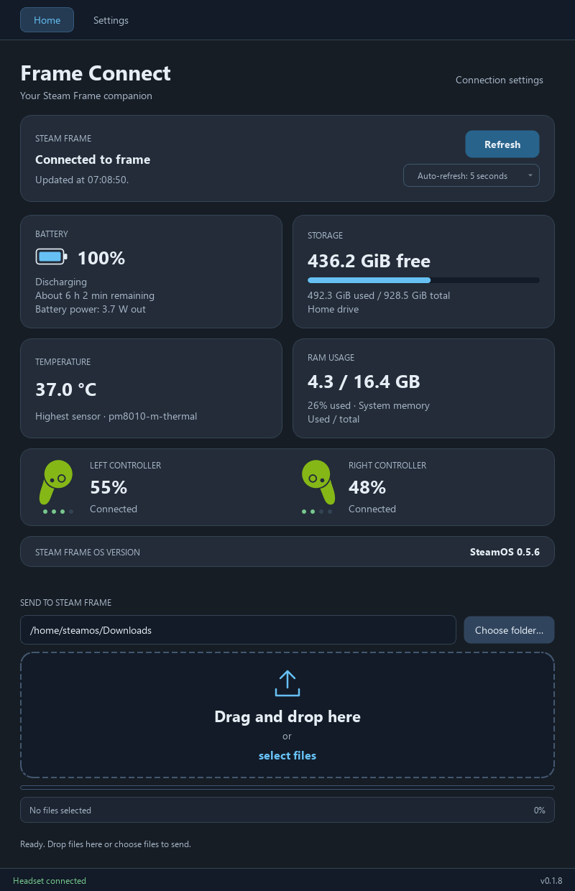

<p align="center">
  
</p>

# Frame Connect - Steam Frame VR Headset Manager

<p align="center">
  <a href="https://github.com/DevctioN/FrameConnect/releases/latest"></a>
  <a href="#github-downloads"></a>
  <a href="https://github.com/DevctioN/FrameConnect/actions/workflows/checks.yml"></a>
  <a href="LICENSE"></a>
</p>

FrameConnect is a free, open-source desktop application for the Valve Steam Frame VR headset. Connect over SSH to see battery, storage, temperature, and RAM usage, and drag files from Windows Explorer into a folder on the headset.

This application is not affiliated with Valve Corporation.

## GitHub downloads

- **Code → Download ZIP** or a Git clone provides the Python source, theme,
  launcher/build scripts, dependency files, README, and tests. Set up the Python
  environment using the instructions below to run it.
- **Releases** provide the Windows x64 download as `FrameConnect-v0.1.8-Windows-x64.zip`.
  Extract it and run `FrameConnect.exe`. Keep the included license notices with
  the app. Python, Qt, the theme, helper scripts and icon are bundled.
- The companion `FrameConnect-v0.1.8-ThirdPartySources.zip` contains the source
  of the Qt/PySide6 libraries shipped in that Windows build.

Frame Connect's own code is licensed under the [MIT License](LICENSE).
Bundled libraries retain their licenses; see [third-party notices](THIRD_PARTY_NOTICES.txt)
and [library sources/rebuilding](SOURCES.md). **Settings → View licenses** opens
the full notices from inside the app.

The ICO folder, local backups, virtual environment, build output, executable,
caches, and files matching the private-key ignore patterns are excluded from
source control. These exclusions keep local files on the development PC;
`.gitignore` does not delete them or upload the executable to Releases.

## Screenshot

<p align="center">
  
</p>

Frame Connect v0.1.8 connected to a Steam Frame, showing live headset readings.

## Run on this PC

Double-click **`FrameConnect.exe`** in the main project folder. This standalone Windows app includes
Python, Qt, the dark theme, and the headset helper scripts. You can move the
executable to another folder; it does not need the project folder or a separate
Python installation. Headset connections still use Windows' OpenSSH `ssh` and
`sftp` commands, along with your existing SSH keys and verified host keys.

### Run from Python instead

Install `uv`, then open PowerShell in the downloaded source folder and run:

```powershell
uv sync --locked
.\.venv\Scripts\python.exe main.py
```

Alternatively, double-click `run.cmd`.

The Python app uses Qt/PySide6 with a fixed Steam-inspired dark blue and charcoal theme.
The top navigation switches between **Home**, which contains the dashboard and
file transfer panel, and **Settings**, which contains connection, power, and diagnostics controls.
Switching pages preserves the connection, readings, selected destination, and any
active upload. The connection footer remains visible on both pages.
Battery, storage, temperature, and RAM usage appear in a two-by-two card layout,
with destination controls above a rounded, dashed file drop area. Its upload
arrow and **select files** link are centered inside. The filename and percentage
sit in a slim, full-width rounded container below the progress bar, with Cancel
underneath on the right.
In a short window, the status area
scrolls so the card text stays readable and the file drop panel stays visible.
A slim footer stays at the bottom, with the app version on the right and
connection status on the left: grey while waiting or connecting, green when
connected, and red on connection errors. Hover over an error for its details.
The battery icon sits beside the percentage and fills to match the reported
charge, with a small lightning bolt centered inside while charging. A full
battery on external power shows **Fully charged**, even if the raw gauge reports
discharging. Charger presence is read separately from the gauge's status using
Linux's [power supply attributes](https://github.com/torvalds/linux/blob/master/Documentation/ABI/testing/sysfs-class-power).
A connected charger below full charge can show **Plugged in · Not charging**
when the gauge reports no charging; an unreadable charger state is left unknown.
When available, the app reads Steam's battery estimate through the
headset's existing local Steam interface. This avoids displaying the lower raw
Linux gauge value when Steam scales it. The headset dashboard can still round
or update differently from Steam's API. If that interface is unavailable, the
app falls back to the raw system percentage; hover over the battery to see
which source is in use. Nothing is installed or enabled on the headset.
The battery details include an approximate time until full while charging, or
remaining use while discharging. Remaining use prefers Steam's own estimate;
charging time uses the battery driver's `time_to_full_now` reading. Missing or
invalid estimates show **Time estimate unavailable**. Estimates update with the
normal refresh and can change with headset load and the charging curve. A
**Fully charged** battery does not show a time-to-full countdown.
**Battery power** shows measured net power at the battery: **W in** while taking
power and **W out** while supplying it. This is calculated from the battery's
current and voltage, not the charger's advertised power. While plugged in, net
battery input is different from the headset's total power consumption.
Before connection, its outline contains a dash; temperature and RAM
show `— °C` and `— / — GB` so the units are visible without invented readings.
The storage card has a rounded blue usage bar: its full width represents total
capacity, and the blue portion represents used space. It is empty at 0% used
and completely blue at 100% used. Before connection, only the dark track is
shown. Free space and used/total capacity remain visible above and below the bar.
A slim OS-version card spans both columns beneath the measurements. It shows
the headset's reported OS name and version after connecting, or **Unavailable**
if version information is missing.
The controller card shows the left and right Steam Frame controllers separately,
with their official SteamVR status icons, battery percentages, and four small
green dots under each icon. Each lit dot represents up to 25% charge (rounded
up); unlit dots are grey. Disconnected controllers show **Not connected**, and a
missing battery reading shows **Battery unavailable**, with no green dots.
Readings use SteamVR's public OpenVR background interface on the headset. This
does not start SteamVR or keep it running. When that interface is unavailable,
controller status shows **Status unavailable** and other monitoring still works.
The official icon files are read from the headset's installed SteamVR resources;
standalone Valve icon files are not bundled with the app.
After the first successful connection, readings refresh automatically about
every 5 seconds by default. Use the **Auto-refresh** dropdown in the connection
card to choose **Never**, **5 seconds**, **10 seconds**, **30 seconds**,
**1 minute**, or **5 minutes**. The selection lasts for this app session.
The connection panel shows when readings were last updated.
Open **Connection settings** to edit the hostname, username, and private key
in a separate dialog. Opening it does not resize the main window.
After a code update, rebuild the executable before reopening it. When running
from source, close the old window and open `run.cmd` again.

The app uses [Qt for Python](https://doc.qt.io/qtforpython-6/) for its interface
and native drag and drop, and the system's OpenSSH/SFTP clients for transfers.
The `PySide6-Essentials` dependency includes the Qt Widgets modules used here. The app
opens without a headset; readings stay empty and file transfer stays disabled
until a connection succeeds. There are no simulated readings in the app.

To recreate the environment on another PC with `uv` installed:

```powershell
uv sync --locked
.\.venv\Scripts\python.exe main.py
```

### Rebuild the Windows executable

The private ICO folder is excluded from the repository. If `ICO/icon.ico` is
absent, the build script creates an icon from the public README logo. You can
also supply your own ICO file. Running the Python source without an ICO still
works, using the default window icon.

From this project folder on Windows:

```powershell
uv sync --locked --group build
.\.venv\Scripts\python.exe prepare_release.py --licenses-only
.\.venv\Scripts\python.exe build_exe.py
.\.venv\Scripts\python.exe prepare_release.py
```

The [PyInstaller](https://pyinstaller.org/en/stable/usage.html) build produces
`FrameConnect.exe` in the main project folder. Build files stay in `build\`. Only the build environment
needs PyInstaller; people running the executable do not need it.

`prepare_release.py` downloads checksum-pinned Qt/PySide6 source archives into
the ignored `release/` folder, refreshes license notices, and creates the Windows
ZIP, companion source ZIP and `SHA256SUMS.txt`. Use `--licenses-only` before
building to prepare notices, then run it again after building to package the new
EXE. Upload both ZIPs and the checksum file to the release. Source files and
license notices belong in Git; generated release downloads do not.

The custom icon is `ICO\icon.ico`. It is embedded in the executable and bundled
for the app's window and taskbar icon. Replace that file and rebuild to change it.
After a successful build, Windows' icon cache is refreshed so Explorer can show
the new executable icon.

## Change the appearance

Edit `styles.qss` and rebuild the executable, or restart when running from
Python. It uses
[Qt Style Sheets](https://doc.qt.io/qtforpython-6/tutorials/basictutorial/widgetstyling.html),
which have CSS-like rules for colors, rounded corners, spacing, and button states.
The interface and headset connection remain Python; no HTML, JavaScript,
web server, or separate browser runtime is required.

## Connection guide

### Try the defaults first

1. Put your PC and the headset on the same trusted network. Keep the headset awake.
2. Open Frame Connect and leave the connection defaults: hostname `frame`,
   username `steamos`, and the SSH key field blank.
3. Click **Connect**.

If the measurements appear, your connection is ready. You do not need to enter
an IP address, set a new password, or create another SSH key for this app.
Leaving the key field blank lets Windows OpenSSH use its existing configuration,
default keys, and any available SSH agent. A successful connection shows that
SSH access already works on that PC; another PC may still need initial setup.

### If the default connection fails

- **Hostname not found:** replace `frame` with the headset's current IP address
  in Connection settings. Entering an IP is only a fallback when the hostname
  cannot be resolved or does not point to the headset.
- **Connection refused or timed out:** check that the headset is awake and
  reachable from the PC, and that SSH access is enabled. Valve's setup guide
  describes enabling **Steam Settings > System > Enable Developer Mode**.
- **SSH is missing:** enable **OpenSSH Client** in Windows Optional Features.
- **Host key verification failed:** connect once in a terminal using
  `ssh steamos@frame` (or the headset's IP) and verify its fingerprint.
- **SSH login failed:** use an existing working key or follow the one-time key
  setup below. The app connects without interactive password prompts.

Valve documents the headset setup in its
[development setup guide](https://partner.steamgames.com/doc/steamhardware/steamframe/setup)
and [SSH debugging guide](https://partner.steamgames.com/doc/steamhardware/steamframe/debugging).

### One-time SSH key setup in PowerShell (only if needed)

Use these steps when the PC does not already have working SSH access for the
app. For initial password-based login in a terminal, Valve's development setup
guide describes enabling Developer Mode and using **Developer > Set User
Password**. That password can be used to install your public key; Frame Connect
itself does not ask for it. Skip this setup if the default connection works.

The commands use the default hostname `frame`. Replace it with the headset's
actual IP only if that hostname does not work on your network.
The piped `Get-Content ... | ssh ...` command appends your public key to the
headset user's authorized keys.
Your private key stays on the PC.

```powershell
$frameHost = 'frame'
$frameKey = Join-Path $env:USERPROFILE '.ssh\id_ed25519_frame_connect'
New-Item -ItemType Directory -Force (Split-Path -Parent $frameKey) | Out-Null
ssh-keygen -t ed25519 -f $frameKey
Get-Content -LiteralPath "$frameKey.pub" | ssh "steamos@$frameHost" 'umask 077; mkdir -p ~/.ssh; cat >> ~/.ssh/authorized_keys'
ssh -i $frameKey "steamos@$frameHost" 'echo SSH connection works'
```

On the first SSH connection, verify the host fingerprint before accepting it.
Enter the headset's Developer Mode password when SSH asks for it.
If a key with that filename already exists, reuse it or choose a new filename
instead of overwriting it. If you protect the key with a passphrase, it must
be loaded into a running `ssh-agent` before the app can use it.

In the app, enter the same host/IP you used above and browse to
`id_ed25519_frame_connect` (the private key, without `.pub`). If you already
have working SSH keys or a `frame` SSH config entry, you can leave the key field
blank and use your existing configuration.

The app uses Windows OpenSSH for noninteractive authentication and requires an
already verified host key. It never saves passwords or changes SSH settings.
The status collector runs
from standard input using `python3 -` on the headset. It reads Linux's
`/sys/class/power_supply` and checks disk usage for the SSH user's home directory.
Temperature comes from `/sys/class/thermal/thermal_zone*/temp`: the card shows
the highest readable thermal-zone temperature in °C and its sensor name.
It does not assume the sensor measures CPU temperature or the headset's surface.
RAM usage comes from `/proc/meminfo`, calculated as `MemTotal - MemAvailable`,
with used/total usable memory in GB as the main value and the percentage below.
RAM uses decimal GB (1 GB = 1,000,000,000 bytes); storage keeps its GiB units.
The total is usable memory reported by Linux. This uses the kernel's
available-memory estimate, which accounts for reclaimable memory. See the
[Linux thermal interface](https://docs.kernel.org/driver-api/thermal/sysfs-api.html)
and [memory reference](https://docs.kernel.org/filesystems/proc.html#meminfo).
The OS version uses Python's
[`freedesktop_os_release`](https://docs.python.org/3/library/platform.html#platform.freedesktop_os_release)
to read `/etc/os-release`, falling back to `/usr/lib/os-release`. It displays
`NAME` plus `VERSION_ID` (or `VERSION`), rather than the Linux kernel version.
After a successful **Connect**, all status cards update automatically at the
selected interval. **Never** disables background checks and automatic retries;
manual checks remain available. Each background check finishes before the next
interval begins, so a slow
connection can take longer between readings. Existing values stay visible during
automatic checks, and file controls remain usable. Background checks leave the
Refresh button's appearance unchanged. Monitoring continues at the
selected interval during uploads and file verification, using a separate
read-only SSH connection. Status-check errors do not cancel a transfer or reset
its filename, percentage or progress. **Never** also disables checks during an
upload. New checks pause while browsing headset folders or requesting shutdown,
then resume afterward if the headset remains connected.
If the headset goes offline, the app marks it **Headset unavailable**, shows
the last update time, disables new transfers, and retries at the selected interval
unless **Never** is selected. The
readings refresh and transfers become available again when a check succeeds.
Changing connection settings stops monitoring until you connect again; closing
the app stops all refresh timers. The main button shows **Refresh** while
connected and **Connect** while disconnected; either performs a manual check.
Missing temperature or RAM data appears as **Unavailable** and does not
prevent connecting or transferring files.
The helper scripts are not installed on the headset and need no `sudo`.

## Error logs

Open **Settings → Open log folder** to find local text logs. On Windows they
are stored in `%LOCALAPPDATA%\Frame Connect\logs`, independently of where you
keep the executable:

- `frame-connect-log.txt`: app version and startup details, connection failures
  and recovery, transfer results, power-request errors, Qt messages, and
  unexpected Python exception tracebacks.
- `frame-connect-crash.txt`: a separate session record and stack traces for
  supported native crashes. A session header alone does not mean a crash occurred.

The main log rotates at approximately 1 MiB and keeps two older copies.
The native crash log is rotated at the next launch if it has reached 1 MiB,
keeping one previous copy. Successful background checks and byte-progress
updates are not logged. Logs stay on your PC; nothing is uploaded automatically.
They can contain headset names, paths, and error details, but the app does not
log private-key contents or file contents. If logging cannot start, Settings
shows the error and the app remains usable.

**Headset unavailable · Retrying…** means a status check failed; it does not
by itself mean the app crashed. Future failures are saved even if you close
the app before reading the tooltip. Errors from before this logging update
cannot be recovered. Sudden power loss or force-terminating the process may
leave no crash traceback.

## Headset power

Connect on **Home**, then open **Settings** and click **Turn off headset**.
Confirm with **Turn off**, or choose **Cancel** to leave the headset running.
Power controls are disabled while disconnected, transferring files, or browsing
headset folders.

The app sends one normal shutdown request through Steam's existing local control
interface using [`System.ShutdownPC()`](https://github.com/kmturley/steam-debug/blob/main/docs/steam-client/System/index.ts).
It does not force a shutdown, request an administrator password, change headset
permissions, or install a service. The interface must be available; an unavailable
or unsupported Steam version produces an error in the Power card.

After Steam acknowledges the request, the app disconnects and stops automatic
retries. **Power-off requested** means the request was accepted, rather than proof
that shutdown has completed. Turn the headset back on using its power button,
then click **Connect** on Home. A timeout or interrupted reply is not automatically
retried, because the headset may already be shutting down.

## Send files to Steam Frame

1. Connect to the headset. The file drop panel is at the bottom of the main screen.
2. Leave the destination as the headset's **Downloads** folder, or click
   **Choose folder…** to browse SteamOS folders. You can also type an absolute
   path such as `/home/steamos/Documents/VR videos`, or a path under `~/`.
   In the folder browser, click a folder once and choose **Use selected folder**.
   Double-click to browse inside it, or choose **Use this folder** with nothing
   highlighted to use the open folder. The selected folder's full path is shown
   before you confirm.
3. Drag one or more files from Windows Explorer into the drop area. The
   **select files** link inside the drop area does the same thing with a file dialog.
4. Watch the progress bar, percentage, and uploaded-file count. **Cancel transfer** stops
   the upload; files already completed stay on the headset.

The default follows the headset's Downloads setting, including a localized or
custom location, with `~/Downloads` as a fallback. Your last chosen destination
is remembered between launches for each headset address and SteamOS username.
Choosing a folder, finishing a typed edit, starting an upload or closing the app
saves a valid path. Reconnecting and refreshing do not replace a custom folder.
Selecting Downloads again restores the default behavior. Preferences are saved
locally in `%LOCALAPPDATA%\Frame Connect\settings.json`, so they also survive
moving or replacing the EXE. Missing or unreadable preferences use Downloads;
no passwords or SSH key contents are stored. Missing destination folders are created when
you send files, subject to your SteamOS user's permissions.

The thin blue bar shows byte progress across all selected files. During uploads,
the app checks the temporary file's size on the headset about once per second.
It stays empty during preparation and fills to 100% once all selected bytes have
been sent. While each file is being verified and published, a short blue segment
loops across the track. The final file briefly shows the full 100% bar before
switching to that verification animation. After all files succeed, the bar
returns to empty and the filename clears, ready for a new upload; the success
message remains visible.
For multiple files, the bar resumes byte progress between verification steps.
Cancellation or failure stops the animation and leaves the last measured byte
progress visible alongside the result message. A missed progress reading does
not abort the transfer. Cancel remains below the bar on the right.

Files are copied, so originals stay on your PC. Existing files are never
overwritten: a name collision stops the batch and is reported in the app.
Rename the PC file or select a different destination to send it again.
This version accepts individual files, including multiple files at once;
uploading whole folders is not included.

Uploads use SFTP and the same SSH identity and verified host key as the status
connection. Each file is uploaded under a temporary name, its size is checked,
and it is published without replacing an existing file. On filesystems that
support hard links, publishing is atomic; other filesystems use an exclusive
copy. An interrupted transfer attempts to remove its temporary file. If the
network prevents cleanup, the error includes the temporary file's location.
Changing connection settings requires connecting again before sending files.

## What is verified

The Windows executable has passed a standalone startup check from outside the
project folder using Qt's offscreen platform. Its bundled Python/Qt runtime,
Windows platform plugin, theme, and headset helper scripts were checked.
This packaging check does not replace testing a connection and upload on the headset.

The local interface, native drop binding, folder browser, collision handling,
cancellation, partial-upload cleanup, and status collector are tested without
a headset. A local integration check also transferred and compared a 1 MiB
binary file using Windows' actual SFTP client, with spaces, brackets, Unicode,
dollar signs, and braces in its name. The Linux battery interface is
documented in the [kernel power supply reference](https://docs.kernel.org/power/power_supply_class.html).
Temperature sensor selection, memory unit conversion, missing readings, and
the four-card layout are covered by local tests using filesystem fixtures.
Hardware testing has confirmed a successful Steam Frame connection with all
status values populated, and a successful file transfer from a Windows PC to
the headset. Automatic refresh, offline recovery, stale-response handling, and
checks starting and completing during transfers are covered by local tests.
Charging estimates, measured battery power, full-on-external-power labels,
controller roles and missing readings, quarter-capacity dots, and the charging
icon are also tested locally. Live read-only checks have confirmed battery
power in both directions and left/right controller percentages and official
icons. The automatic monitoring cadence, offline recovery, and headset folders beyond the tested
destination still need hardware verification. Missing battery data is shown as
**Unavailable**.
Home/Settings navigation, confirmation and cancellation, power-request errors,
monitoring cleanup, and late-response handling are covered by local tests.
The user has confirmed successful remote shutdown on a Steam Frame, with green
success messages in both the bottom connection footer and the Settings Power card.
Automated development checks do not switch the headset off.

Byte progress is tested for unequal file sizes, missing or regressing samples,
empty files, cancellation, and completion. A local integration check used
Windows' native SFTP client to copy and compare a 4 MiB file, with intermediate
progress measured from the growing staging file. The bar and button positions
were also checked at small and normal window sizes.

```powershell
.\.venv\Scripts\python.exe -m unittest discover -s tests -v
```

The same suite runs on Windows in [GitHub Actions](https://github.com/DevctioN/FrameConnect/actions/workflows/checks.yml)
for pushes to `main` and pull requests. The **checks** badge above reports the
latest push result on `main`; it gets its first result after the workflow is
pushed and runs on GitHub. These tests use local fixtures and do not connect to
or change a real headset.

## Code map

- `main.py`: starts logging, then launches the app.
- `diagnostics.py`: local rotating logs, exception hooks, and native crash traces.
- `preferences.py`: remembers the destination folder for each headset/account.
- `build_exe.py`: packages the standalone Windows executable.
- `prepare_release.py`: prepares license notices, checked library sources, and release ZIPs.
- `app.py`: Home/Settings navigation, connection, status, power, and file transfer interface.
- `theme.py`: Qt dark palette and thin rounded transfer progress bar.
- `styles.qss`: CSS-like Qt rules for the Steam-inspired interface.
- `headset.py`: shared SSH options, status validation, and confirmed power requests.
- `probe.py`: read-only collector executed on the headset.
- `vr_status.py`: read-only OpenVR controller batteries and runtime status icons.
- `steam_api.py`: shared standard-library client for Steam's local control interface.
- `remote_power.py`: separate explicit Steam shutdown request executed on the headset.
- `folder_picker.py`: remote SteamOS folder chooser.
- `transfers.py`: SFTP uploads, cancellation, and folder requests.
- `remote_files.py`: temporary headset-side folder and upload helper.
- `tests/`: isolated UI, transport, and filesystem tests.

Status readings, file transfer, and remote shutdown have been confirmed on a
Steam Frame.
